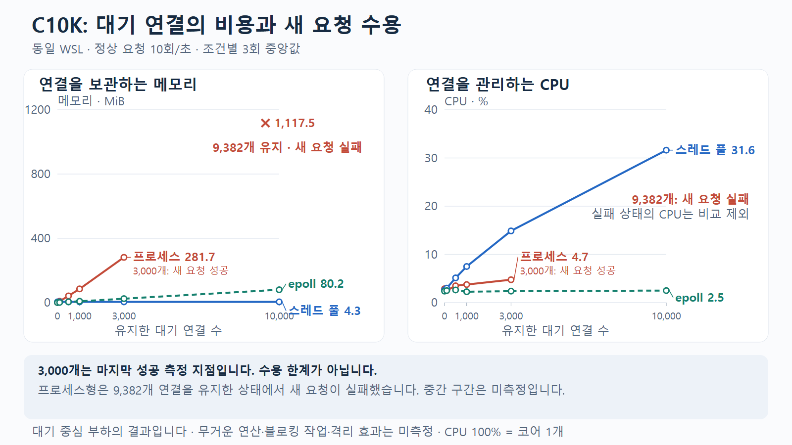

# 연결 10,000개를 감당하려면, 실행 주체도 10,000개가 필요할까?

동시 접속자가 10,000명이라고 해서 10,000개의 작업이 항상 실행 중인 것은 아닙니다. 다음 요청이나 데이터 전송을 기다리는 연결도 있습니다.

**C10K는 많은 연결을 감당하면서 요청도 처리해야 하는 문제입니다.** 저희는 이를 두 가지 관점으로 나눠 살펴봤습니다.

> **기다리는 연결을 유지하는 비용은 무엇인가?**  
> **준비된 요청들을 어떻게 실행할 것인가?**

전자는 실험으로 확인하고, 후자는 각 구현의 구조를 바탕으로 비교했습니다. 여기서 10,000개는 동시에 유지하는 연결 수이며, 동시 요청 10,000개나 초당 요청 10,000개를 뜻하지 않습니다.

## 1. 세 구현은 무엇을 선택했나?

| 구현 | 연결이 기다릴 때 | 요청을 실행할 때 | 선택의 대가 |
|---|---|---|---|
| 연결별 프로세스 (`nuri`) | 연결마다 자식 프로세스를 유지 | 여러 프로세스가 여러 코어에서 실행 가능. 주소 공간 분리 | 순차적인 처리 흐름을 작성하기 쉽지만, 대기 연결도 프로세스 자원을 차지 |
| poll + 스레드 풀 (`ljw`) | 메인이 연결을 감시하고 작업자는 다른 일을 처리 | 고정 작업자들이 여러 코어에서 실행 가능 | 작업자를 재사용하지만, 공유 상태 동기화와 작업 배정이 필요 |
| 단일 epoll 루프 (`shw`) | 연결 상태를 보관하고 준비된 이벤트를 기다림 | 한 스레드가 여러 연결의 처리를 번갈아 진행 | 적은 실행 주체로 연결을 관리하지만, 긴 연산이나 블로킹 작업이 다른 연결도 지연 |

프로세스형은 **연결마다** 자식을 만듭니다. 하나의 연결에서 여러 요청을 순차 처리하므로 process-per-request와는 다릅니다.

스레드 풀 구현 역시 연결마다 스레드를 만드는 방식이 아니라 **poll과 고정 작업자를 조합한 방식**입니다. 멀티플렉싱과 멀티스레드는 함께 사용할 수 있습니다.

## 2. 먼저, 많은 연결을 유지하는 비용을 측정했다

> **대기 연결을 늘려도 새 정상 요청을 계속 처리할 수 있을까?**

같은 로컬 WSL에서 세 서버를 하나씩 실행했습니다. 정상 GET 응답을 받은 연결들을 keep-alive 상태로 유지하고, 별도의 새 연결로 동일한 1KiB 파일을 요청했습니다.

| 조건 | 설정 |
|---|---|
| 대기 연결 수 | 0 → 100 → 500 → 1,000 → 3,000 → 10,000개 |
| 추가 정상 요청 | 초당 10개씩 8초간 전송 |
| 반복 | 조건별 3회 |
| 비교 조건 | 실험 복사본의 연결 상한·유휴 시간·빌드 최적화 수준을 맞춤 |

**많은 연결이 기다리는 동안, 가벼운 새 요청을 받아낼 수 있는지 확인하는 실험입니다.** 모든 연결이 동시에 작업하는 상황이나 최대 처리량을 측정한 것은 아닙니다.

### 연결 유지에 쓰는 자원이 다르게 나타났다

- **프로세스형:** 연결마다 프로세스가 증가했습니다. 대기 연결 3,000개에서 부모 포함 3,001개 프로세스가 유지됐고, 메모리 사용도 증가했습니다.
- **poll + 스레드 풀:** 실행 주체 수는 고정됐지만, 서버 CPU 사용량이 대기 연결 0개에서 약 2.6%, 10,000개에서 약 31.6%로 증가했습니다.
- **epoll:** 10,000개에서도 서버 CPU 사용량은 약 2.5%였으며, 연결별 상태와 버퍼를 유지하면서 메모리가 증가했습니다.

스레드 풀의 CPU 증가에는 연결 감시·순회·타이머 관리 등이 포함됩니다. 메모리 차이에도 버퍼 배치와 고정 풀의 크기가 영향을 주므로, 수치 전체를 동시성 모델 하나의 효과로 단정하지는 않습니다.

### 새 요청을 처리할 여유도 남았나?

| 구현 | 유지한 연결 수 | 추가 정상 요청 성공 |
|---|---:|---:|
| 연결별 프로세스 | 9,382개 | 0 / 240 |
| poll + 스레드 풀 | 10,000개 | 240 / 240 |
| 단일 epoll 루프 | 10,000개 | 240 / 240 |

프로세스형은 **3,000개 조건에서는 추가 요청도 모두 성공**했습니다. 연결을 더 늘린 시도에서는 9,382개를 유지한 상태에서 새 요청이 실패했습니다.

그래프의 3,000개는 마지막 성공 측정 지점이며 수용 한계가 아닙니다. 그 사이 구간에서 새 요청이 어디까지 성공하는지는 측정하지 않았습니다. 실패 상태에서는 정상 요청을 처리하지 못했으므로 그 CPU 값은 비교에서 제외했습니다.

## 3. C10K에서 드러난 트레이드오프

프로세스형의 기존 연결들은 이미 응답을 받은 뒤 다음 요청을 기다리고 있었습니다. 하지만 자식 프로세스는 계속 남아 있었습니다.

이번 환경에서는 WSL의 작업 수 한도에 도달해 새 요청을 담당할 자식을 만들지 못했습니다.

> **연결마다 독립적인 실행 흐름을 두면 처리를 순차적으로 작성하기 쉽지만, 기다리는 연결도 실행 자원을 차지합니다.**

직접적인 제한은 `TasksMax=9,392`였습니다. 한도를 높이면 실패 지점은 달라질 수 있으므로, 프로세스 방식으로 C10K가 불가능하다는 결과는 아닙니다. 다만 **연결 수가 늘면 프로세스 수도 늘어나는 비용 구조**는 남습니다.

반면 스레드 풀과 이벤트 루프는 대기 연결과 실행 주체를 분리해, 실행 주체 수를 늘리지 않고 10,000개 연결을 유지했습니다.

> **대기와 실행을 분리하면 실행 주체의 유지 비용을 줄일 수 있지만, 연결 상태와 작업의 중단·재개를 직접 관리해야 합니다.**

## 4. 그럼 실제 작업도 epoll로 처리하면 될까?

이번 부하에서는 기다리는 연결이 많고 실제 작업은 가벼웠습니다. **이 조건에서는 단일 epoll 구현의 장점이 확인됐습니다.**

하지만 각 요청이 처리할 일이 많아지면 다른 선택이 중요해집니다.

| 작업의 성격 | 동시 요청 처리에서의 트레이드오프 |
|---|---|
| 긴 CPU 계산 | 프로세스나 스레드 풀은 여러 코어에서 작업을 실행할 수 있음. 단일 이벤트 루프에서 계산을 오래 수행하면 다른 연결 처리가 지연됨 |
| 블로킹 작업 | 별도 작업자에게 맡기면 다른 요청 처리를 이어갈 수 있음. 다만 작업자가 모두 막히면 후속 작업이 기다림 |
| 장애 격리 | 프로세스는 주소 공간을 분리하지만 유지 비용이 듦. 스레드는 메모리를 공유하므로 동기화와 오류의 영향 범위를 고려해야 함 |
| 코드 흐름 | 순차 처리는 흐름을 따라가기 쉽지만, 이벤트 방식은 처리 진행 상태를 저장하고 이어가야 함 |

**이 항목들은 구현 구조에 따른 고려사항이며, 이번 실험으로 성능이나 효과를 직접 검증한 것은 아닙니다.**

또한 epoll은 준비된 소켓을 알려주는 기능이고, 프로세스와 스레드는 작업을 실행하는 단위이므로 양자택일이 아닙니다. 이벤트 루프로 연결을 관리하면서 무거운 작업은 스레드 풀에 맡기거나, 여러 이벤트 루프 프로세스를 실행할 수도 있습니다.

## 5. 연결 유지와 작업 실행을 나눠 선택한다

> **많은 연결을 적은 비용으로 유지하는 능력과, 실제 작업을 병렬로 실행하고 장애를 격리하는 능력은 다릅니다.**

이번 실험은 전자를 중심으로 **대기 연결을 유지하는 자원 비용과 새 요청 수용 여부**를 확인했습니다.

그 결과만으로 한 모델을 최종 승자로 고르기보다, 서버 설계에서는 작업의 성격에 따라 연결을 관리하는 방식과 실제 작업을 실행하는 방식을 함께 고려해야 합니다.

---

[전체 결과와 해석](c10k-experiment/results/REPORT.md) · [실험 조건 및 재현 방법](c10k-experiment/README.md) · [공통 스크립트](c10k-experiment/benchmark.py) · [통합 CSV](c10k-experiment/results/combined.csv)
