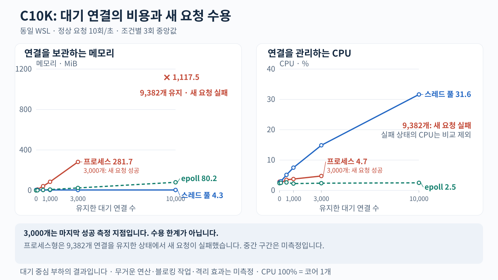

# 로컬 C10K 연결 유지 실험 결과

환경: Intel(R) Core(TM) i5-8265U CPU @ 1.60GHz, WSL 논리 CPU 8개. 실행 커널: `Linux-6.18.33.2-microsoft-standard-WSL2-x86_64-with-glibc2.43`.

**환경 제한:** systemd init.scope의 TasksMax=9392는 변경하지 않았다. nuri의 10000 목표는 이 작업 수 한도에서 fork EAGAIN으로 막혔다. 스레드 풀/epoll의 연결 수는 같은 수의 실행 주체를 요구하지 않는다. 근거: [한도 기록](system-limits.txt), `nuri-10000-r*.log`. 이 환경의 결과를 모델의 보편적인 수용 한도로 해석하지 않는다.

같은 WSL에서 같은 1KiB 파일, 유휴 시간 600초, O2 빌드로 측정했다. 정상 요청은 초당 10회, 각 조건 8초 × 3회다. 아래 지연은 **각 회차 p95의 중앙값**이며 240개 요청을 합친 p95가 아니다. 메모리는 측정 직전 PSS 합계의 중앙값이다.

| 브랜치 | 목표 연결 | 실제 유지 전/후 | 회차 | 프로세스/스레드 | PSS MiB | 정상 요청 성공/전체 | p95 중앙값 ms (회차 범위) | CPU % 중앙값 |
|---|---:|---|---:|---|---:|---:|---|---:|
| ljw | 0 | 0/0, 0/0, 0/0 | 3 | 1/5 | 4.29 | 240/240 | 16.02 (15.99–16.31) | 2.62 |
| ljw | 100 | 100/100, 100/100, 100/100 | 3 | 1/5 | 4.33 | 240/240 | 16.17 (16.05–16.41) | 3.00 |
| ljw | 500 | 500/500, 500/500, 500/500 | 3 | 1/5 | 4.33 | 240/240 | 17.52 (17.45–18.22) | 5.12 |
| ljw | 1000 | 1000/1000, 1000/1000, 1000/1000 | 3 | 1/5 | 4.33 | 240/240 | 19.25 (18.95–19.39) | 7.50 |
| ljw | 3000 | 3000/3000, 3000/3000, 3000/3000 | 3 | 1/5 | 4.33 | 240/240 | 24.62 (10.38–24.71) | 14.87 |
| ljw | 10000 | 10000/10000, 10000/10000, 10000/10000 | 3 | 1/5 | 4.33 | 240/240 | 36.37 (34.42–40.58) | 31.62 |
| nuri | 0 | 0/0, 0/0, 0/0 | 3 | 1/1 | 0.41 | 240/240 | 12.12 (12.05–12.50) | 2.87 |
| nuri | 100 | 100/100, 100/100, 100/100 | 3 | 101/101 | 8.71 | 240/240 | 12.48 (12.05–12.49) | 2.50 |
| nuri | 500 | 500/500, 500/500, 500/500 | 3 | 501/501 | 41.85 | 240/240 | 12.43 (12.30–12.58) | 3.50 |
| nuri | 1000 | 1000/1000, 1000/1000, 1000/1000 | 3 | 1001/1001 | 85.06 | 240/240 | 12.32 (12.01–12.47) | 3.75 |
| nuri | 3000 | 3000/3000, 3000/3000, 3000/3000 | 3 | 3001/3001 | 281.72 | 240/240 | 12.66 (12.28–12.67) | 4.75 |
| nuri | 10000 | 9382/9382, 9382/9382, 9382/9382 | 3 | 9383/9383 | 1117.54 | 0/240 | — | 5.23 |
| shw | 0 | 0/0, 0/0, 0/0 | 3 | 1/1 | 0.24 | 240/240 | 33.07 (32.86–34.50) | 2.37 |
| shw | 100 | 100/100, 100/100, 100/100 | 3 | 1/1 | 1.04 | 240/240 | 34.51 (33.03–34.57) | 2.50 |
| shw | 500 | 500/500, 500/500, 500/500 | 3 | 1/1 | 4.24 | 240/240 | 35.03 (33.08–35.31) | 2.62 |
| shw | 1000 | 1000/1000, 1000/1000, 1000/1000 | 3 | 1/1 | 8.24 | 240/240 | 32.31 (30.39–33.51) | 2.25 |
| shw | 3000 | 3000/3000, 3000/3000, 3000/3000 | 3 | 1/1 | 24.23 | 240/240 | 31.41 (30.53–33.40) | 2.37 |
| shw | 10000 | 10000/10000, 10000/10000, 10000/10000 | 3 | 1/1 | 80.20 | 240/240 | 31.82 (30.86–32.88) | 2.50 |

## 해석 범위

- 기본 실행의 nuri 3000/10000 미실행 항목은 추가 실행 결과가 있을 때 대체한다. 추가 실행 환경은 nuri-high.jsonl.environment.json 참조.
- 0연결 메모리에는 각 구현의 고정 할당이 포함된다. 증가량도 함께 비교해야 한다.
- 이 부하는 포화 처리량 측정이 아니다. 지연으로 모델의 일반적인 속도 순위를 매길 수 없다.
- PSS는 사용자 공간 메모리이며 커널 소켓·프로세스 유지 비용 전체가 아니다.
- 같은 WSL의 부하 발생기와 Windows 마운트 파일/로그 I/O가 결과에 영향을 준다.
- EOF 미관찰로 확인한 전후 연결 수이며 측정 중 전체 연결의 연속 생존 검증은 아니다.
- 실험용 조건 변경과 측정 정의는 상위 README 및 패치 파일을 참조한다.

## 원자료

[CSV](measurements.csv) · [JSONL](measurements.jsonl) · [커밋](commits.json) · [환경](measurements.jsonl.environment.json)

[통합 CSV](combined.csv) · 추가 실행 원자료가 있으면 `nuri-high.jsonl`에 보관.

## 발표에서 사용할 수 있는 관찰

1. 연결 수와 실행 주체 수는 같은 개념이 아니다. 실제 프로세스·스레드 수 열로 확인한다.
2. nuri의 연결별 프로세스 유지, shw의 연결별 구조체/버퍼 유지, ljw의 사전 할당 연결 슬롯 및 고정 context 풀이 서로 다른 메모리 곡선을 만든다.
3. ljw의 낮은 추가 PSS는 대기 연결이 무료라는 뜻이 아니다. 12000개 연결 슬롯을 위한 고정 할당이 0연결 기준에도 포함되고, 커널 소켓 비용은 이 표에서 빠진다.
4. poll의 감시 비용과 epoll의 이벤트 기반 처리는 CPU 변화의 설명 후보다. CPU 수치에는 타이머 순회·로그·요청 처리 등도 포함되므로 poll 하나의 비용으로 단정하지 않는다.
5. 성공한 조건은 “다수 연결을 유지하며 초당 10개 정상 요청을 처리했다”는 증거다. 모든 연결의 동시 요청 처리나 최대 처리량을 증명하지 않는다.
